# VisionStress MVP plan and completion checklist

This plan tracks the new full-stack VisionStress MVP. Check an item only after the implementation has been run and verified. Preserve the working Phase 1 CLI and its measured baseline as the web app is built around it.

## Existing foundation — verified

- [x] Create the Python package, configuration, setup, validation, and baseline CLI.
- [x] Pin and verify official YOLO11n/s/m checkpoint hashes before loading them.
- [x] Download and validate a fixed 128-image COCO val2017 subset (906 annotations).
- [x] Evaluate real predictions with COCOeval and save predictions, metrics, manifests, hashes, and environment details.
- [x] Compare YOLO11n/s/m on the same images and settings. YOLO11m is the current default; its measured mAP@0.5:0.95 was 0.5741 on this development subset.

The COCO subset and existing runs are a development benchmark, not an independent test set or a redistributable demo package. The [README](README.md) documents the exact setup and baseline method. Existing CLI functionality must continue to pass as the architecture changes.

## Phase 1 — Architecture and runnable vertical slice

- [x] Inspect the existing repository and define the updated implementation plan.
- [x] Establish a monorepo layout for FastAPI, the worker, React/TypeScript/Vite/Tailwind, tests, and documentation.
- [x] Add PostgreSQL runtime models and Alembic migrations; use SQLite only in automated tests.
- [x] Add a filesystem artifact-storage interface, Docker Compose services, and health checks.
- [x] Implement the smallest complete slice: create a project; register one valid YOLO-format dataset and one approved checkpoint; queue baseline plus seeded stress; run it in a separate worker; save real metrics; display the job and result in the dashboard.
- [x] Verify the API/worker slice end to end on CPU against PostgreSQL and retain measured jobs and a report as evidence.
- [ ] Complete visual browser QA of the dashboard; the browser tool failed to initialize in this session.

**Acceptance:** One documented command starts API, worker, database, and frontend; a user can finish the slice without manually editing database rows. HTTP requests remain responsive during inference. No result is hardcoded.

## Phase 2 — Dataset ingestion and trusted model registry

- [x] Implement project create/list/edit/delete API and dashboard create/list flows.
- [ ] Add dashboard project edit/delete controls.
- [x] Register YOLO-format datasets with image/label pairing, allowed formats, readable dimensions, normalized box bounds, valid class IDs, and duplicate checks.
- [ ] Reject traversal, symlinks outside the storage root, oversized uploads, unsafe archives, and decompression bombs; test these failures.
- [x] Create deterministic, disjoint validation/test splits; store their manifests and hashes so leakage is detectable.
- [x] Show dataset image count, box count, class distribution, and sample images.
- [x] Register only approved YOLO11 detection checkpoints by trusted local path and pinned SHA-256; record checkpoint name, provenance, supported classes, and hash. Keep model uploads disabled.
- [ ] Add configurable per-model inference settings to the registry; current fixed settings are saved per run.
- [x] Require matching model and dataset class names/order before evaluation.

**Acceptance:** Invalid datasets and unapproved checkpoints are rejected before inference. A registered dataset can be independently revalidated against its stored manifest.

## Phase 3 — Deterministic stress and evaluation

- [x] Implement brightness/contrast, Gaussian blur, motion blur, Gaussian noise, JPEG compression, fog, rain, partial occlusion, color shift, and defocus, each at severity 1–5 with an explicit seed.
- [x] Save exact per-image transform parameters; test seeded determinism, image geometry, and color handling.
- [x] Keep label-preserving transforms in the core benchmark. Mark occlusion as exploratory because labels may be hidden.
- [x] Run original and stressed images with the same confidence, NMS, image size, class mapping, and evaluator settings.
- [x] Use COCOeval for precision, recall, mAP@0.5, mAP@0.5:0.95, and supported per-class results; keep inference latency separate.
- [x] Save raw predictions, ground truth, degradation, sample-size warnings, undefined metrics, seeds, model/dataset hashes, code hash, library versions, and evaluation settings.
- [x] Test evaluator correctness on known examples and degradation math, including zero or undefined baselines.
- [x] Verify metric reproducibility across repeated runs in the same PostgreSQL environment to a documented tolerance.
- [ ] Decide whether to integrate the unmaintained MIT Albumentations package or its AGPL/commercial successor; current transforms use OpenCV/NumPy.

**Acceptance:** Repeating a run in the same environment reproduces transformed images and metrics within documented numerical tolerances. Reported numbers come from saved inference artifacts.

## Phase 4 — Dashboard and failure discovery

- [x] Build responsive overview, dataset/model registration, new-evaluation, job-status, and result views with empty and error states.
- [ ] Add dedicated explorer views and polished loading states, then complete visual browser QA.
- [ ] Show robustness overview, metric trends by condition/severity, per-class impact, and model version comparison from API data.
- [x] Identify false negatives, false positives, and localization failures with a documented simple class-aware matching rule.
- [x] Rank examples by new false negatives, false positives, and localization failures.
- [ ] Add repeatability ranking and clustering of visually similar failures.
- [x] Show original and transformed images side by side with ground truth and predictions; save confidence and transform settings in linked artifacts.
- [x] Test the API-backed project-creation frontend workflow with Vitest.
- [ ] Test the full create-to-result frontend workflow.

**Acceptance:** A user can trace a metric change to the underlying images, labels, predictions, and transformation parameters.

## Phase 5 — Regression suites, jobs, reports, and CI

- [x] Save named suites of selected failure cases, including dataset references, seeds, transforms, model configuration, and prior results recalculated on the selected cases.
- [x] Rerun suites against an approved model, compare outcomes on the same images, and apply a configurable absolute metric-drop threshold with pass/fail/inconclusive results.
- [x] Export measured machine-readable JSON and a standalone human-readable HTML demo report.
- [x] Persist job state, progress, timestamps, errors, retries, and cancellation; run one worker at a time and enforce an execution timeout.
- [x] Add API error-handling and job-state tests.
- [x] Add suite selection, gate, and same-model reproducibility checks against the PostgreSQL worker.
- [ ] Add archive/upload-security tests if an archive upload feature is introduced; registration currently accepts local directories only.
- [x] Add GitHub Actions definitions for backend pytest, frontend Vitest/build, and migration checks; equivalent local checks passed.
- [ ] Verify the workflow in GitHub Actions after code is published.

**Acceptance:** Restarting API or worker does not lose queued or completed jobs; a rerun produces a reviewable comparison and explicit pass/fail gate result.

## Phase 6 — Demo and documentation

- [x] Provide a one-command CPU demo that obtains the COCO sample through documented user-side download/setup, verifies an approved model, runs baseline plus three stress conditions, and generates a report.
- [x] Run the demo against PostgreSQL and the worker, inspect outputs, fix failures, and record exact commands and measured results.
- [x] Update README with installation, quick start, API examples, YOLO data specification, architecture, model trust and licensing, evaluation method, limitations, and an example customer workflow.
- [x] Re-run backend and frontend checks and record unresolved limitations without fabricated results.

**Acceptance:** A new contributor can reproduce the demo from documented commands on a CPU machine with Docker and downloaded assets.

## Architecture target

```mermaid
flowchart LR
    UI[React dashboard] --> API[FastAPI and OpenAPI]
    API --> DB[(PostgreSQL)]
    API --> STORE[(Filesystem artifact store)]
    WORKER[Separate bounded worker] --> DB
    WORKER --> STORE
    WORKER --> ENGINE[Verified YOLO + COCOeval]
```

The API queues evaluations rather than running inference in a request. The worker claims durable jobs, verifies inputs, writes artifacts through a storage interface, and commits progress and results. PostgreSQL is the runtime database; SQLite is only for tests. The filesystem store should permit a future S3 implementation without changing the evaluation engine.

## Current evidence, assumptions, and blockers

- The existing CLI baseline passed on 22 November 2026 with Python 3.13.5 and CPU PyTorch 2.15.0; the prior tests and `pip check` passed. Local run directories are Git-ignored.
- Existing measured mAP@0.5:0.95 on the 128-image development subset: YOLO11n 0.4522, YOLO11s 0.5316, YOLO11m 0.5741. Selecting the default on this subset can bias later comparisons; use a separate test split for claims about generalization.
- Ultralytics code and checkpoints have AGPL-3.0 or Enterprise licensing terms. COCO images retain their owners' rights. The demo must download assets into ignored local storage rather than commit them. Synthetic stress results are diagnostic and are not safety certification.
- The PostgreSQL demo completed three jobs on 22 November 2026 using the locally downloaded 8-image COCO YOLO conversion (6 validation images, 54 boxes total). All three jobs remained completed after API/worker restart. Baseline mAP@0.5:0.95 was 0.3981; severity-3 brightness, Gaussian blur, and JPEG yielded 0.4055, 0.3995, and 0.3974. These are tiny-sample integration results, not production robustness estimates.
- A repeat of the seeded brightness job matched baseline and stressed accuracy metrics within 1e-6. Ground-truth and per-image transformation-parameter artifacts matched byte-for-byte. Inference timing is hardware/load dependent and is excluded from the tolerance.
- On 22 November 2026, a PostgreSQL regression suite selected two brightness failure images from job 1. A same-model candidate job completed with reference and candidate mAP@0.5:0.95 both 0.3471875491, so the 0.02-drop gate passed. Saved per-image transform parameters matched exactly; the 1e-6 accuracy tolerance passed. The two-image result is diagnostic only.
- `pytest` passed 22 tests; frontend Vitest passed 2 tests, frontend production build passed, `pip check` found no broken requirements, and the frontend dependency audit reported zero vulnerabilities. Docker Compose API, web, proxy, sample-image, and comparison-image HTTP checks returned 200.
- Browser visual QA could not run because the browser tool failed to initialize. Archive upload security, clustering, authentication, and broader frontend workflows remain open.
- Model uploads remain disabled. Never deserialize an unverified user-provided checkpoint or execute user-supplied model code.
- This work made no Git staging, commit, or push changes.
