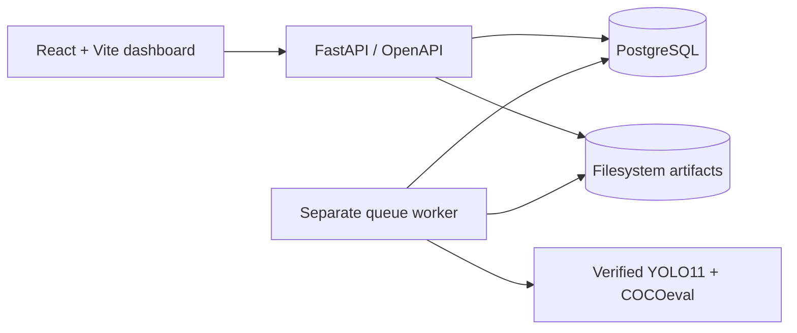

# VisionStress

VisionStress evaluates how object detection models perform under controlled visual degradation. The original CLI baseline remains available. A new FastAPI/PostgreSQL worker and React dashboard now provide a first runnable web-app slice: project and dataset registration, trusted YOLO checkpoint registration, queued baseline plus one selected stress condition, and measured results.

**Status:** CLI Milestone 1 completed and verified on CPU. The web MVP is in progress; see [PLAN.md](PLAN.md) for the acceptance checklist and verified evidence.

## Existing CLI baseline

- Evaluate a real pretrained, CPU-compatible YOLO detector on a real labeled dataset, with GPU acceleration when available.
- Measure precision, recall, mAP@0.5, mAP@0.5:0.95, per-class AP where supported, false positives, false negatives, and inference latency using documented evaluation settings.
- Record configuration, seeds, model and dataset hashes, software versions, hardware, predictions, and evaluation settings for reproducibility.

The original CLI phase had no frontend or stress runs. The new local web slice adds those capabilities and is not yet an authenticated multi-user service. Synthetic corruptions approximate real-world conditions; a small benchmark is not a safety certification.

## Install and run Milestone 1

Use Python 3.11 or newer. In PowerShell, from the repository root:

```powershell
py -3.13 -m venv .venv
.\.venv\Scripts\python.exe -m pip install -e ".[dev,report]"
.\.venv\Scripts\visionstress.exe setup --config configs/benchmark.yaml
.\.venv\Scripts\visionstress.exe validate --config configs/benchmark.yaml
.\.venv\Scripts\visionstress.exe baseline --config configs/benchmark.yaml
.\.venv\Scripts\python.exe -m pytest
```

Use `python3 -m venv .venv`, `.venv/bin/python`, and `.venv/bin/visionstress` on macOS or Linux. Setup downloads the official YOLO11 medium checkpoint and a [pinned 20 MB mirror of COCO val2017 annotations](https://huggingface.co/datasets/pcuenq/coco2017-instances/blob/main/instances_val2017.json), then downloads the first 128 validation images in sorted image ID order from the official COCO S3 bucket. The full annotation file is discarded after extracting the fixed subset. Downloads may take several minutes. The checkpoint and dataset are stored in ignored `models/` and `data/` directories.

The model URL, SHA-256, image hashes, annotation hash, effective configuration, software versions, hardware, raw predictions, ground truth, and baseline metrics are saved for each run under an ignored, unique `outputs/` directory. `validate` verifies the checkpoint hash before deserialization and checks each image, annotation, box, and class mapping. The configurable model path must point to one of the supported YOLO11 checkpoints (`n`, `s`, or `m`) and its setup manifest.

The verified baseline comparisons on 22 November 2026 used Python 3.13.5, PyTorch 2.15.0+cpu, Ultralytics 8.4.216, and pycocotools 2.0.11. All three used the same images and evaluation settings at 640-pixel input:

| Checkpoint | Config | mAP@0.5 | mAP@0.5:0.95 | Precision | Recall | Mean inference time (CPU) |
| --- | --- | ---: | ---: | ---: | ---: | ---: |
| YOLO11n | `configs/benchmark_nano.yaml` | 0.6068 | 0.4522 | 0.7247 | 0.5512 | 102.7 ms/image |
| YOLO11s | `configs/benchmark_small.yaml` | 0.7007 | 0.5316 | 0.7309 | 0.6169 | 171.7 ms/image |
| **YOLO11m (default)** | `configs/benchmark.yaml` | **0.7322** | **0.5741** | 0.7269 | 0.6492 | 430.4 ms/image |

Measured results are in the local, Git-ignored `outputs/20261122T085514Z_78c0cf1a`, `outputs/20261122T093236Z_529dad02`, and `outputs/20261122T093330Z_29cdde77` directories, respectively. The medium checkpoint improves mAP@0.5:0.95 by 0.1219 absolute over nano while taking about 4.2 times as long per image on this CPU. These comparisons use the same 128 images to choose the default model, so treat them as exploratory selection results; confirm generalization on an independent image set before making performance claims.

## Evaluation method

The checkpoints are [Ultralytics YOLO11 detection models](https://docs.ultralytics.com/models/yolo11/) from the [official v8.3.0 asset release](https://github.com/ultralytics/assets/releases/tag/v8.3.0). Verified SHA-256 hashes are `0ebbc80d4a7680d14987a577cd21342b65ecfd94632bd9a8da63ae6417644ee1` (nano), `85a76fe86dd8afe384648546b56a7a78580c7cb7b404fc595f97969322d502d5` (small), and `d5ffc1a674953a08e11a8d21e022781b1b23a19b730afc309290bd9fb5305b95` (medium). The dataset uses a fixed slice of the [COCO 2017 validation split](https://cocodataset.org/#download). It avoids the COCO128 training images. This is a small development benchmark, so results should not be treated as production estimates.

Inference uses 640-pixel input, confidence 0.001, NMS IoU 0.7, and up to 300 raw detections per image. [COCOeval](https://github.com/cocodataset/cocoapi) computes mAP@0.5 and mAP@0.5:0.95 over IoU 0.50–0.95 in steps of 0.05, with at most 100 detections per image. Per-class AP is reported only for classes with at least five non-crowd examples. Precision, recall, true positives, false positives, and false negatives use COCOeval matching at confidence 0.25 and IoU 0.5, including its crowd and ignore handling. Average model inference time is reported separately in milliseconds per image from Ultralytics timing. These settings are configurable in `configs/benchmark.yaml` and saved in each run.

COCO annotations use [CC BY 4.0](https://cocodataset.org/dataset/termsofuse.htm); individual images retain their owners' rights and are subject to Flickr terms. [Ultralytics YOLO11 models and code](https://docs.ultralytics.com/models/yolo11/) are offered under AGPL-3.0 and Enterprise licenses. Review licensing before commercial distribution.

The remaining CLI commands are planned for later milestones:

```text
visionstress run --config configs/benchmark.yaml
visionstress report --run-id <run_id>
```

The report command is intended to regenerate a report from saved results without rerunning inference. Downloaded datasets, model weights, and generated outputs stay outside version control.

## Development milestones

The original CLI baseline is complete. The current full-stack milestone checklist and acceptance criteria are in [PLAN.md](PLAN.md).

## Web MVP: local quick start

The web app uses PostgreSQL at runtime, a separate single-concurrency worker, and local filesystem artifacts. Docker Desktop or another working Docker daemon is required. From the repository root, prepare the trusted checkpoint and locally downloaded COCO sample, then start the stack:

```powershell
.\.venv\Scripts\python.exe -m pip install -e ".[dev,report]"
.\.venv\Scripts\python.exe -m visionstress.service.demo_data
docker compose up --build -d
```

Open `http://localhost:5173` for the dashboard and `http://localhost:8000/docs` for OpenAPI. Create a project; register folder `demo_coco8` as a dataset; register `yolo11n.pt` as the approved model; then queue a brightness, Gaussian blur, or JPEG evaluation. The worker evaluates the validation split and stores raw artifacts under `outputs/web/job-<id>/`. The demo images and weights remain in Git-ignored local folders.

The one-command demo is:

```powershell
.\.venv\Scripts\python.exe scripts\demo.py
```

It prepares the user-side COCO download, starts Compose if needed, queues baseline plus brightness, Gaussian blur, and JPEG runs at severity 3, waits for measured results, and writes `outputs/demo_report.html` and `outputs/demo_report.json`. This full PostgreSQL workflow was verified locally on CPU on 22 November 2026. A CPU smoke test of the same API and worker logic can be run without Docker; it uses SQLite only as an automated test database:

```powershell
.\.venv\Scripts\python.exe scripts\smoke_web.py
```

After running the PostgreSQL demo, check seeded repeatability with:

```powershell
.\.venv\Scripts\python.exe scripts\repro_check.py
```

Run checks:

```powershell
.\.venv\Scripts\python.exe -m pytest -q
cd web
npm ci
npm run test
npm run build
```

On PowerShell installations that block `npm.ps1`, use `npm.cmd` in place of `npm`.

## Web architecture



The API persists a queued job and returns immediately. The worker claims one job at a time with a database row lock, verifies the dataset content hash and pinned model SHA-256 again, runs inference, saves raw predictions and reproducibility metadata, and commits the result. The storage interface is in `LocalArtifactStore` so it can be replaced by an S3 implementation. Alembic migrations create the database schema; the API container applies them on startup. PostgreSQL data is kept in a Compose volume.

## YOLO dataset format and trust boundaries

Place a dataset inside `data/<directory>/`:

```text
data/<directory>/
  classes.json        # JSON array of class names in model class-ID order
  images/0001.jpg
  labels/0001.txt     # one row per box: class_id center_x center_y width height
```

Coordinates must be normalized to `[0,1]`; boxes must have positive size and fit in the image. Every image needs a same-stem `.txt` file, even when there are no objects. Registration checks readable dimensions, label syntax, class IDs, duplicate image content, file sizes, and that all resolved paths stay inside the configured data root. It stores a content hash and deterministic, disjoint validation/test split. Registration accepts only a simple named directory under `data/`; archive upload and extraction are not implemented yet. Images are capped at 20 MB and 30 million pixels each; datasets at 500 images. The current API has no authentication and should be bound only to a trusted local environment.

Only the official, pinned `yolo11n.pt`, `yolo11s.pt`, and `yolo11m.pt` files under `models/` can be registered. Their source manifest and SHA-256 are verified before any Ultralytics load. The web API has no checkpoint-upload endpoint. The model's class names and order must match `classes.json` exactly. This avoids deserializing arbitrary user-supplied PyTorch pickle files; it is not a general sandbox for untrusted models.

## API examples

The full schema and interactive requests are at `/docs`. A minimal flow is:

```text
POST /api/projects       {"name":"Drone detector","description":"Development benchmark"}
POST /api/datasets       {"project_id":1,"name":"COCO demo","directory":"demo_coco8"}
POST /api/models         {"project_id":1,"checkpoint":"yolo11n.pt"}
POST /api/evaluations    {"project_id":1,"dataset_id":1,"model_id":1,"stress":"brightness","severity":2,"seed":42,"max_images":6}
GET  /api/jobs/1
GET  /api/jobs/1/artifacts/result.json
```

Projects can be listed, edited, and deleted; registered datasets and models can be listed per project. Jobs can be listed, cancelled, and retried after failure (up to three attempts). A job records status, progress, timestamps, error, request settings, and results. Artifacts include COCO ground truth, baseline and stressed predictions, per-image transform parameters, environment, result JSON, ranked failure examples, and annotated original/stressed image pairs. The worker enforces a 30-minute evaluation timeout; cancellation is checked between images. Stale running jobs are marked failed when the worker restarts after the timeout window.

## Evaluation method and limits

For the web slice, inference uses 640-pixel input, confidence 0.001, NMS IoU 0.7, and up to 300 raw detections. COCOeval reports AP at IoU 0.50 and across 0.50–0.95, with up to 100 detections; precision and recall count class-aware matches at confidence 0.25 and IoU 0.5. Baseline and stress use the same settings. Inference latency is recorded separately from accuracy. Brightness, brightness/contrast, Gaussian blur, motion blur, Gaussian noise, JPEG compression, fog, rain, partial occlusion, color shift, and defocus are implemented at severity 1–5. Exact settings and per-image seeds are saved. Occlusion runs are marked exploratory because an occluded object may make its original label invalid. Undefined metrics are represented as JSON `null`, and per-class AP is withheld below five ground-truth examples. The remaining failure explorer, regression suites, and deployment gates are tracked in [PLAN.md](PLAN.md).

The failure gallery uses a separate, simple class-aware greedy match at confidence 0.25 and IoU 0.5. It counts new misses, false detections, and overlapping boxes below the match IoU, then ranks images by a documented weighted score. This is an inspection aid; COCOeval remains the source of the reported benchmark metrics. The first three ranked examples are saved with green ground-truth boxes and red predictions. Repeatability ranking and visual clustering remain planned work.

The local CPU smoke evaluation of 6 validation images measured baseline mAP@0.5:0.95 of 0.3981 and brightness-severity-2 mAP@0.5:0.95 of 0.3978. The PostgreSQL demo at severity 3 measured baseline 0.3981, brightness 0.4055, Gaussian blur 0.3995, and JPEG 0.3974. These tiny-sample results only check the end-to-end machinery; the modest blur/brightness gains are not evidence of general robustness. The report and raw artifacts are Git-ignored under `outputs/`. Different checkpoint versions and hardware can change timings and, occasionally, floating-point outputs. See each run's `environment.json` and raw artifacts for reproducibility details.

A repeat of the seeded brightness job produced the same ground-truth and per-image transform-parameter artifacts byte-for-byte, and baseline/stressed accuracy metrics matched within 1e-6 in this environment. Inference latency is deliberately excluded from that tolerance because system load affects timing.

Ultralytics [documents AGPL-3.0 and Enterprise terms](https://docs.ultralytics.com/) for its models and code. Review the applicable terms before commercial integration. The [COCO dataset terms](https://cocodataset.org/dataset/termsofuse.htm) apply to annotations; individual images have their owners' rights. The repository does not redistribute images or model weights. The core web components were chosen from permissive projects: [FastAPI MIT](https://github.com/fastapi/fastapi/blob/master/LICENSE), [SQLAlchemy MIT](https://github.com/sqlalchemy/sqlalchemy/blob/main/pyproject.toml), [OpenCV Apache-2.0](https://github.com/opencv/opencv/blob/5.x/LICENSE), and the [PostgreSQL License](https://www.postgresql.org/about/licence/). The requested Albumentations dependency is not yet used: its [MIT-licensed original is unmaintained and the successor AlbumentationsX is AGPL-3.0/commercial](https://github.com/albumentations-team/albumentations). The first slice uses direct OpenCV/NumPy transforms to retain explicit parameters and deterministic behavior; a later integration needs a license and maintenance decision.
